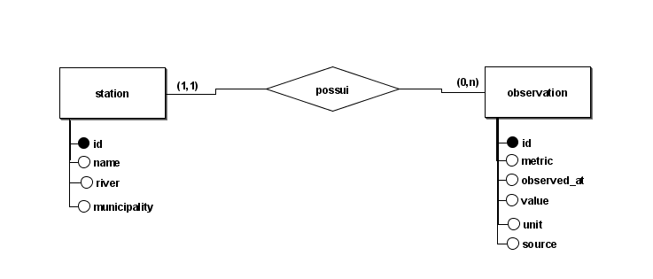
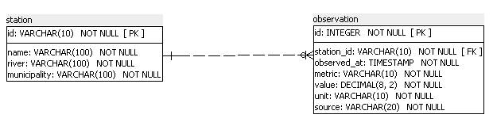

# Modelo de dados

O sistema armazena estações hidrológicas fictícias e as observações (leituras) de nível de rio e chuva de cada uma. Todos os dados são **simulados** e não descrevem rios reais.

## Modelo conceitual (MER/DER)

Feito no BRModelo. O arquivo da imagem é `Modelo_Conceitual_DER_Monitoramento_Hidrologico.png`.

**Entidades**

| Entidade | Atributos | Descrição |
|---|---|---|
| `station` | `id` (identificador), `name`, `river`, `municipality` | Estação hidrológica. O `id` é um código textual, como `EST-01`. |
| `observation` | `id` (identificador), `metric`, `observed_at`, `value`, `unit`, `source` | Uma leitura de uma estação em um horário. |

**Relacionamento `possui`:** uma estação possui zero ou muitas observações, e cada observação pertence a exatamente uma estação.

> **Como ler as cardinalidades do diagrama:** o par escrito ao lado de uma entidade indica quantas ocorrências **dela** se associam a uma ocorrência da outra entidade. Assim, `(1,1)` junto de `station` significa que cada observação está ligada a exatamente uma estação, e `(0,n)` junto de `observation` significa que cada estação tem de zero a várias observações.

## Modelo relacional (físico)

Feito no SQL Power Architect. O arquivo da imagem é `Modelo_Relacional_MER_Monitoramento_Hidrologico.png`.

**Tabela `station`**

| Coluna | Tipo | Restrições |
|---|---|---|
| `id` | VARCHAR(10) | chave primária |
| `name` | VARCHAR(100) | obrigatória |
| `river` | VARCHAR(100) | obrigatória |
| `municipality` | VARCHAR(100) | obrigatória |

**Tabela `observation`**

| Coluna | Tipo | Restrições |
|---|---|---|
| `id` | INTEGER | chave primária, gerada automaticamente |
| `station_id` | VARCHAR(10) | chave estrangeira para `station.id`, obrigatória |
| `metric` | VARCHAR(10) | obrigatória, `level` ou `rain` |
| `observed_at` | TIMESTAMP | obrigatória, em UTC |
| `value` | número real (ponto flutuante) | obrigatória |
| `unit` | VARCHAR(10) | obrigatória, `m` ou `mm/h` |
| `source` | VARCHAR(20) | obrigatória, padrão `synthetic` |

## Regras de integridade

- **Chave estrangeira:** `observation.station_id` referencia `station.id`. Excluir uma estação exclui suas observações (`CASCADE`).
- **Unicidade da observação:** não pode haver duas observações com a mesma estação, métrica e horário (`station_id`, `metric`, `observed_at`). Isso permite executar o seed várias vezes sem duplicar linhas. Esse trio também tem um índice, para acelerar a consulta do histórico.
- **Unicidade da estação:** `name`, `river` e `municipality` não se repetem juntos.
- **Métrica válida:** `metric` só aceita `level` ou `rain`.
- **Unidade coerente com a métrica:** `level` usa `m` e `rain` usa `mm/h`.

As regras de métrica e unidade são verificadas pelo próprio banco (restrições `CHECK`), e não apenas pela aplicação.
